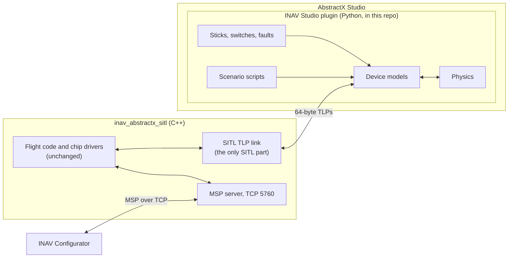

# SITL: INAV on the AbstractX TLP API, with no hardware

Status: **plan, nothing below is implemented yet** (2026-11-07). What exists today is described at the end.

## 1. Why

SITL is where INAV is moved onto AbstractX's TLP API and where the problems that move exposes are found and fixed, before any hardware. Every emulated device speaks the real 64-byte TLP format, so a wrong field, channel, byte order or timing in INAV fails here instead of on the aircraft.

## 2. The parts

## 3. Requirements

### `[SPEC-SITL-01]` Only the transport differs
* **Requirement**: The SITL binary runs the same flight code and chip drivers as the aircraft. The only SITL-specific code is the TLP link (§3, [SPEC-SITL-03]). No `#ifdef` and no SITL branch in flight code or drivers.
* **Why**: SITL proves nothing about the aircraft if it runs different code.
* **Verified by**: `sitl-mission-review`
* **Not implemented yet**: today SITL drives the loop from `sitl_main.cpp` and feeds the IMU straight into a ring.

### `[SPEC-SITL-02]` AbstractX's TLP format, not AbstractX's simulation
* **Requirement**: Every TLP on the link uses AbstractX's 64-byte layout and its type and channel values (`AbstractX/include/asp_tlp64.hpp`, `AbstractX/docs/tier2_contracts/TLP_BUS_SPECIFICATION.md`). `length` is AbstractX's `length_dw`, a count of 32-bit words: a request for N bytes asks for `(N + 3) / 4` words, and the receiver uses `length_bytes()`. Device addresses come from AbstractX's register map (`AbstractX/include/pcie_bar_map.hpp`). INAV keeps no copy of the format or the map (owner, 2026-11-07). SITL does not use AbstractX's simulation, fakes or loopback: the link, the device models and the physics are INAV's.
* **Why**: INAV must be on the same API it uses on hardware, and the emulation is INAV's choice of devices and aircraft (owner, 2026-11-07).
* **Verified by**: `sitl-mission-review`
* **Implemented** (2026-11-07): INAV's copies of `asp_tlp64.hpp` and `pcie_bar_map.hpp` are deleted, `length` is in words, checked by `test/test_tlp_wire_format.cpp`. **Not implemented yet**: the link and the models in the plugin.

### `[SPEC-SITL-03]` The link
* **Requirement**: The SITL binary and the plugin exchange whole 64-byte TLPs over a local socket. There is no CRC: INAV never reads or writes the TLP's last 4 bytes, and on this link they are 0 (AbstractX uses them only on serial links). The link counts dropped TLPs and does nothing else.
* **Why**: CRC and delivery belong to the transport, never to INAV (owner, 2026-11-07).
* **Verified by**: `sitl-mission-review`
* **Not implemented yet**: socket type and port to be decided (§5).

### `[SPEC-SITL-04]` Lockstep, paced by the IMU
* **Requirement**: Simulated time comes only from the TLP `timestamp_ns`, never the wall clock. The IMU sample is the clock: INAV runs one loop step per IMU sample, and the plugin sends the next sample only after it has the motor commands for the previous one. The loop rate is 1 kHz of simulated time. SITL may run slower than real time.
* **Why**: Python cannot produce samples on time at 1 kHz; lockstep makes timing jitter irrelevant and makes every run repeatable. It is the primary-paced pattern INAV already uses.
* **Verified by**: `sitl-mission-review`
* **Not implemented yet**

### `[SPEC-SITL-05]` The devices
* **Requirement**: The plugin emulates exactly the aircraft's devices, each defined only by the TLPs it exchanges. The physical bus (SPI, I2C, UART, PIO) belongs to the board and is not emulated.

  | Device | INAV sends | The model returns |
  | :--- | :--- | :--- |
  | IMU, ICM-42688-P | Register reads and writes | Its register map: ID, configuration, data. A sample per step from the physics, paced as data-ready |
  | Compass, QMC5883L | Register reads and writes | Its register map: ID, status, field for the current heading and tilt |
  | GPS | Bytes it sends are accepted | NMEA sentences as a byte stream, from the physics |
  | RC, PWM decoder | Nothing | 6 channel pulse widths in µs (16-bit, little-endian), about 50 Hz. On signal loss it stops sending |
  | Motors, DShot600 | 4 motor commands | Nothing; commands go to the physics |
  | LEDs, NeoPixel | Colour frames | Nothing; frames are shown |

  There is no barometer; INAV must run without one.
* **Why**: SITL has to exercise the drivers the aircraft runs, at the TLP level they actually use.
* **Verified by**: `sitl-mission-review`
* **Not implemented yet**: today only an ICM-42688-P sample is pushed. INAV also has two PWM parsers with opposite byte order (`src/drivers/rc/pwm_rc.hpp`, `src/drivers/rc_driver.hpp`), and `PwmRc` detects RC loss from throttle below 900 µs rather than from missing frames.

### `[SPEC-SITL-06]` Physics in the plugin
* **Requirement**: The plugin holds the only SITL physics: a QuadX rigid body with gravity, motor thrust and torque from the DShot commands, drag, wind and ground contact. It keeps the true state (attitude, rates, position, velocity) so checks can compare INAV's estimate with it.
* **Why**: one owner for the physics, next to the models and controls that use it.
* **Verified by**: `sitl-mission-review`
* **Not implemented yet**: the C++ physics in `src/target/sitl/hardware_simulator.hpp` is what runs today.

### `[SPEC-SITL-07]` Controls in Studio
* **Requirement**: The plugin shows on-screen sticks and switches (roll, pitch, throttle, yaw, CH5 arm, CH6 mode) and also reads a USB joystick, so a transmitter in joystick mode can fly SITL, and can serve a touch-stick web page so a phone on the local network can fly it. Every source ends up as the same PWM decoder TLPs ([SPEC-SITL-05]). It offers, at any time: RC loss, GPS loss and fix quality, a stuck or failed sensor, sensor noise, a failed motor, and wind and gusts. It shows the motor outputs and the LED colours.
* **Why**: failsafe and fault handling must be tried by hand, not only described.
* **Verified by**: `sitl-mission-review`
* **Not implemented yet**: `tools/studio_plugin/inav_plugin.py` is today an MSP client and display; it has a stick display but drives nothing.

### `[SPEC-SITL-08]` Scenario scripts
* **Requirement**: A Python script can drive sticks and faults on simulated time and check results against the true state and INAV's MSP state. Scripts run without the GUI, so they can run in tests, and the same script gives the same result every run ([SPEC-SITL-04]).
* **Why**: repeatable checks, not one-off manual flights.
* **Verified by**: `sitl-mission-review`
* **Not implemented yet**

### `[SPEC-SITL-09]` INAV Configurator over TCP
* **Requirement**: INAV Configurator connects to the SITL binary over TCP on port 5760 and every tab it opens works: the MSP commands it sends are answered from the flight code's real state, and it can enter CLI mode.
* **Why**: setup and tuning use the standard tool.
* **Verified by**: `sitl-mission-review`
* **Not implemented yet**: the handshake and about 35 MSP v1 commands exist. The settings commands, INAV MSP2 commands and CLI mode (`#`) are not wired; the exact list comes from logging what the Configurator sends that goes unanswered.

### `[SPEC-SITL-10]` Later: HITL with the same plugin
* **Requirement**: The same plugin and TLPs can drive the real board instead of the SITL binary, with models standing in for devices that are not connected.
* **Why**: one set of models for SITL and HITL.
* **Verified by**: `board-bringup`
* **Not implemented yet**

## 4. Order of work

1. These requirements.
2. Put INAV on AbstractX's TLP format ([SPEC-SITL-02]).
3. The link and lockstep ([SPEC-SITL-03], [SPEC-SITL-04]).
4. One device at a time: IMU, compass, GPS, RC, DShot, LEDs ([SPEC-SITL-05]), fixing each driver problem as it shows, then physics, controls and scripts.
5. AbstractX's runtime in place of INAV's coroutine engine.
6. Configurator ([SPEC-SITL-09]).

Problems found go in [`ENGINEERING_LOG.md`](ENGINEERING_LOG.md).

## 5. Open

* Link socket type and port.
* Which register map governs device addresses: INAV's `include/pcie_bar_map.hpp` or AbstractX's.
* What happens to `src/target/sitl/hardware_simulator.hpp` once the plugin has the physics.
* GPS sentences and rate (GGA and RMC at 5 or 10 Hz proposed).
* Idea, not a requirement yet: a flight trainer (phone sticks into Studio, beginner rates and angle mode, instructor takeover, lessons as scenario scripts, replay).
* This file is not named `*SPECIFICATION.md`, so AbstractX's `spectrace_matrix.py --root inav` finds none of its requirements (0 found on 2026-11-07). Rename it, or move the requirements to a `SITL_SPECIFICATION.md`.
* `sitl-mission-review` describes today's C++ test funnel; it needs a section that runs the plugin's scenario scripts.

## 6. What exists today (before this plan)

* `src/target/sitl/sitl_main.cpp`: the SITL binary. Steps the C++ physics, pushes ICM-42688-P samples into a ring, runs EKF, navigation, PID and mixer, MSP on TCP 5760, blackbox to disk.
* `src/target/sitl/hardware_simulator.hpp`: QuadX rate dynamics and an accelerometer gravity vector; no position, compass, GPS, RC or motor protocol.
* `tools/studio_plugin/inav_plugin.py`: Studio plugin acting as an MSP client with flight deck, PID, receiver, motor, sensor, GPS and CLI tabs.
* Build and run from the `flight` workspace: `cmake --workflow --preset sitl`, then `build/sitl/inav/inav_abstractx_sitl`.
